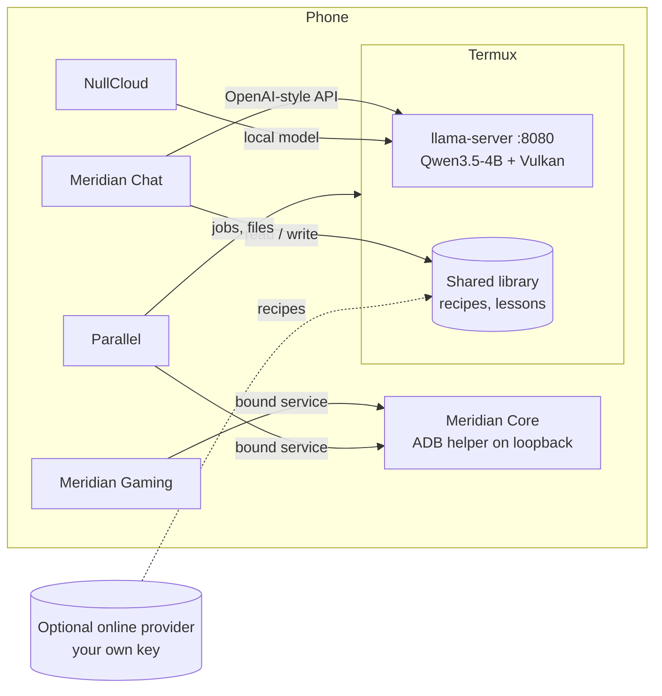

# Architecture

## Meridian Core: elevation without root

1. Core connects to the phone's own adb daemon: Wireless debugging, or `127.0.0.1:5555` after `adb tcpip 5555`.
2. It pushes a small starter script and launches `app_process` as the shell user, in its own session, so the helper outlives the adb connection and survives Wi-Fi off.
3. The helper listens on a random loopback port and only accepts clients that present a one-time token.
4. Family apps call Core through a bound service; Core forwards to the helper. If Core is restarted, it re-attaches to the running helper.

## Meridian Chat: local and online roles

- **Local model (on the phone):** the one that talks to you. Answers from the recipe library, skills and web search.
- **Online agent (optional):** turns a large skill tree into short "how to do it" recipes for the shared library.
